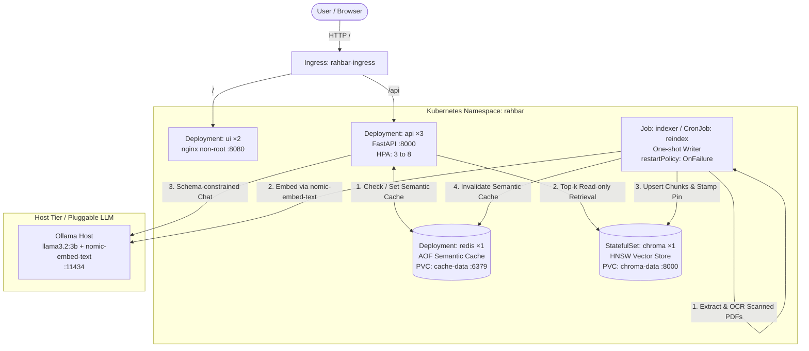

# RAHBAR: Grounded Academic RAG on Kubernetes


A student wants to know whether they can register for a prerequisite course after failing an earlier attempt. General-purpose language models respond with absolute confidence, describing rules from other institutions because they have never ingested yours. **RAHBAR** bridges this gap: fluency is not factuality. RAHBAR is a grounded, schema-constrained question-answering system over official FAST-NUCES university documents, deployed on Kubernetes. It embeds questions, retrieves relevant passages from a persistent ChromaDB vector store indexed ahead of time, validates citations against actually retrieved evidence, and declines honestly when knowledge is absent.

---

## Team Members
- **Hassan Zahid** — `Hassan-Zahid110`
- **Faisal** — `faisalmemon353`

*Course: Software Construction and Development (SCD) — FAST-NUCES Islamabad*

---
---

## Architecture Overview

RAHBAR enforces a strict separation of concerns: **the Indexer is the sole writer to the vector store and semantic cache; the horizontally autoscaled API Deployment only reads on every question.**



---

## API Endpoints

The API is exposed behind Ingress routing at `/api/*` and enforces JSON-formatted structured logging with request IDs (`X-Request-ID` propagation) on stdout.

| Method | Path | Purpose | Behavior & Dependencies |
|---|---|---|---|
| GET | `/healthz` | **Liveness Probe** | Checks that the Python FastAPI process is alive. **Touches zero external dependencies** (no Chroma, no Redis, no LLM) to prevent slow-dependency restart storms. |
| GET | `/readyz` | **Readiness Probe** | Returns `200` only if: (1) Chroma is reachable, (2) the collection is non-empty (`count > 0`), (3) Redis is reachable, and (4) the collection's indexed `embed_model` matches the configured `EMBED_MODEL`. Returns `503` naming any failing dependency. |
| GET | `/metrics` | **Prometheus Metrics** | Exposes Prometheus text-format metrics: request count and latency histogram, retrieval latency, generation latency, semantic cache hit ratio, abstention count by reason, fallback count, and in/out tokens. |
| POST | `/api/ask` | **Grounded QA** | Validates `AskRequest` (question: 3 to 500 chars). Executes 8-step pipeline: cache check -> embed query -> retrieve top-k -> relevance floor check -> augmented generation -> citation validation with 1 retry -> safe fallback -> returns `AskResponse`. |

### Response Contract (`POST /api/ask`)
```json
{
  "request_id": "a6b47c92f0",
  "answer": "A student whose cumulative grade point average (CGPA) falls below 2.00 at the end of a regular semester is placed on academic warning [academic-rules-handbook-jun-2026.pdf / 5.4 Academic Warning].",
  "citations": [
    {
      "source": "academic-rules-handbook-jun-2026.pdf",
      "section": "5.4 Academic Warning",
      "page": 18
    }
  ],
  "answered_from_context": true,
  "confidence": "high",
  "retrieved": [
    {
      "chunk_id": "academic-rules-handbook-jun-2026-0034",
      "source": "academic-rules-handbook-jun-2026.pdf",
      "section": "5.4 Academic Warning",
      "page": 18,
      "score": 0.895
    }
  ],
  "provider": "ollama",
  "cached": false
}
```

---

## Getting Started: Clean Clone to Running Service

### 1. Prerequisites
- Docker Desktop (or containerd)
- `minikube` (with `kubectl`)
- Python 3.12
- Local Ollama running with host binding:
  ```bash
  OLLAMA_HOST=0.0.0.0 ollama serve
  ollama pull llama3.2:3b
  ollama pull nomic-embed-text
  ```

### 2. Start the Cluster with Calico CNI
Calico is required so Kubernetes `NetworkPolicy` manifests are actively enforced (the default Minikube CNI silently ignores NetworkPolicies):
```bash
minikube start --driver=docker --cni=calico --memory=6144 --cpus=4
minikube addons enable metrics-server
minikube addons enable ingress
```

### 3. Build Container Images & Load Into Minikube
```bash
docker build -t rahbar-api:dev api
docker build -t rahbar-indexer:dev indexer
docker build -t rahbar-ui:dev ui
minikube image load rahbar-api:dev
minikube image load rahbar-indexer:dev
minikube image load rahbar-ui:dev
```

### 4. Apply Manifests in Exact Documented Order
Apply Kubernetes manifests using Kustomize overlays:
```bash
# 1. Create namespace
kubectl apply -f k8s/base/namespace.yaml

# 2. Create the Secret from the CLI (never committed to Git)
kubectl create secret generic rahbar-secret -n rahbar \
  --from-literal=LLM_API_KEY="placeholder-not-needed-for-ollama-host" \
  --dry-run=client -o yaml | kubectl apply -f -

# 3. Apply the complete dev overlay (Services, ServiceAccounts, ConfigMap, PVCs, StatefulSet, Deployments, NetworkPolicies, HPA, Ingress)
kubectl apply -k k8s/overlays/dev

# 4. Wait for data tier rollout
kubectl rollout status statefulset/chroma -n rahbar --timeout=120s
kubectl rollout status deployment/redis -n rahbar --timeout=120s
```

*(Note: At this stage, `deployment/api` will sit at `0/1 READY` because the index is not yet built. This is the intended behavior of the Section 4.4 guardrail).*

### 5. Run the Indexer Job
To build the index for the first time, run the one-shot Indexer Job:
```bash
kubectl wait --for=condition=complete job/indexer -n rahbar --timeout=300s
```
To trigger a manual zero-downtime re-indexing later without redeploying:
```bash
kubectl create job --from=cronjob/reindex manual-reindex-1 -n rahbar
```

Once the Indexer Job completes and writes chunk vectors into Chroma, the API's `/readyz` probe immediately detects the valid index, passes, and all 3 API replicas transition to `1/1 READY`:
```bash
kubectl rollout status deployment/api -n rahbar --timeout=60s
kubectl rollout status deployment/ui -n rahbar --timeout=60s
```

### 6. Map Ingress Host and Ask a Question
Add `rahbar.local` to `/etc/hosts`:
```bash
echo "$(minikube ip) rahbar.local" | sudo tee -a /etc/hosts
```
*(On macOS Docker driver, run `minikube tunnel` in a separate terminal and map `127.0.0.1 rahbar.local`).*

Ask through the Ingress via curl or `make ask`:
```bash
curl -s -X POST http://rahbar.local/api/ask \
  -H "Content-Type: application/json" \
  -d '{"question": "What CGPA puts a student on academic warning?"}' | jq
```

Or open `http://rahbar.local` in your browser to chat via the web UI.

---

## Using Groq as the LLM Provider

Groq serves open models (Llama 3.x) behind an OpenAI-compatible API with a free tier. `LLM_PROVIDER=groq` is a preset over the hosted provider: it fills in `HOSTED_BASE_URL=https://api.groq.com/openai/v1` and `LLM_MODEL=llama-3.1-8b-instant` unless you override them in the ConfigMap. Get a key at https://console.groq.com/keys.

**Locally (no cluster):**
```bash
export LLM_API_KEY="gsk_..."   # never commit this
make dev-groq                  # http://localhost:8000
```

**On the cluster:**
```bash
export LLM_API_KEY="gsk_..."
make secret                                                     # Secret from the CLI, never a file
kubectl patch configmap rahbar-config -n rahbar --type merge -p '{"data":{"LLM_PROVIDER":"groq"}}'
kubectl rollout restart deployment/api -n rahbar
```
API egress on TCP 443 is already allowed by `k8s/base/networkpolicy.yaml`. The embedding model stays pinned (`EMBED_MODEL`): Groq only replaces generation, not retrieval.

---

## Security Disciplines (Section 4.7)

1. **Zero Secrets in Git**: `*-secret.yaml` and `.env` are gitignored. Committed templates contain `REPLACE_ME` and are excluded from `kustomization.yaml`.
2. **Dedicated ServiceAccounts**: Every workload uses its own ServiceAccount with `automountServiceAccountToken: false`.
3. **Containers as Non-Root**: All pods enforce `runAsNonRoot: true`, `readOnlyRootFilesystem: true` (with `/tmp` mounted as `emptyDir`), and drop all Linux capabilities (`drop: ["ALL"]`).
4. **Default-Deny NetworkPolicy**: `default-deny-all` blocks all traffic; explicit egress rules allow only DNS (port 53 to `kube-system`), UI->API, API->Chroma/Redis/Ollama, and Indexer->Chroma/Redis/Ollama. UI pods are physically barred from reaching Chroma.
5. **Untrusted Data Isolation**: Document passages and user questions are delimited inside `<retrieved_evidence>` and `<user_question>` XML blocks, validated against Pydantic schemas, and never passed to `eval()` or used to construct raw queries.

---

## Rollout, Scaling and Rollback Verification (Section 4.6)

1. **Zero-Downtime Rolling Update**:
   ```bash
   kubectl set image deployment/api api=rahbar-api:dev -n rahbar
   kubectl rollout status deployment/api -n rahbar
   ```
   Guaranteed by `maxSurge: 1`, `maxUnavailable: 0`, and a `preStop: sleep 5` hook ensuring connection draining.
2. **One-Command Rollback**:
   ```bash
   kubectl rollout undo deployment/api -n rahbar
   kubectl rollout status deployment/api -n rahbar
   ```
3. **Horizontal Pod Autoscaling**:
   ```bash
   kubectl get hpa -n rahbar
   kubectl get endpoints api -n rahbar
   ```
   Shows 3 to 8 pods responding to load with automatic clusterIP endpoint discovery.


<!-- Contributor Matrix: Hassan Zahid (Lead) & Faisal Memon (Groq & Retrieval) -->
